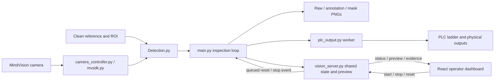

# System design strategy

## Function analysis

The current application separates native camera access, comparison logic and PLC communication into Python modules. `main.py` coordinates inspection. `vision_server.py` hosts a service object and local HTTP API; React renders the operator dashboard.

One inspection worker owns one camera. HTTP handlers read snapshots or queue commands. The PLC worker maintains communication independently, although inspection completion drives its health freshness. JPEG generation and PNG saving currently run in the inspection loop; they are not isolated background services.

## Functional evaluation

Strengths are the reusable CLI path, explicit hardware adapter and independent PLC worker. The main coupling is `main.run_camera(args, bridge)`: it updates bridge fields directly and both modules participate in alarm state. The service also accesses the PLC object's lock and fields directly. These contracts are implicit and make future changes harder to review.

Duplicate HTTP port protection prevents two instances on the same port; it does not prevent another port, the CLI or a vendor application from competing for the same camera. Stop is cooperative and cannot interrupt a blocked native call. Preview encoding and evidence I/O add variable work to the inspection path.

## Proposed responsibility boundaries

| Component | Owns | Should not own |
| --- | --- | --- |
| Camera adapter | Device selection, SDK lifetime, frame acquisition | Alarm policy or HTTP state |
| Detection engine | ROI comparison and structured regions | PLC actions or storage paths |
| Inspection controller | Counters, alarm latch, lifecycle and command decisions | HTTP response formatting |
| PLC adapter | Protocol, desired signals, connection diagnostics | Image classification or browser state |
| Evidence repository | Event IDs, durable image set, metadata and lookup | Camera lifetime |
| API layer | Validated contracts and command tracking | A second alarm state machine |
| Dashboard | Presentation and command feedback | Authoritative equipment state |

Introduce a structured inspection result, immutable status snapshot and command result before moving code between files. Keep the existing entrypoints working during extraction. This document proposes a later code reorganization; the documentation split does not perform that refactor.

## Delivery sequence and acceptance gates

1. **Make operation diagnosable.** Add startup stages, version/process identity and readable SDK/PLC errors. Gate: an operator can distinguish missing SDK, camera busy, reference mismatch and PLC outage.
2. **Validate detection quality.** Build a labelled dataset and freeze reference/configuration provenance. Gate: agreed recall, false-alarm and latency targets pass on held-out cases.
3. **Extract the inspection controller.** Consolidate alarm transitions and command ownership behind typed boundaries. Gate: existing alarm/reset tests pass and start/stop/restart cases are covered.
4. **Strengthen evidence storage.** Add event manifests, incomplete-write handling and retention. Gate: failures cannot create a record that falsely claims a complete evidence set.
5. **Control performance and delivery.** Profile first; consider a bounded latest-frame preview worker and safe precomputation of reference processing. Gate: browser clients and slow storage have measured, acceptable effects on inspection latency.
6. **Complete operator and release checks.** Add browser workflows, long-run hardware evaluation and a deployment checklist. Gate: labelled build, validated configuration and recorded equipment acceptance.

Do not add network exposure or editable live detector settings until ownership, access control and configuration-change behavior are defined. Preserve the local deployment model for the current release.
